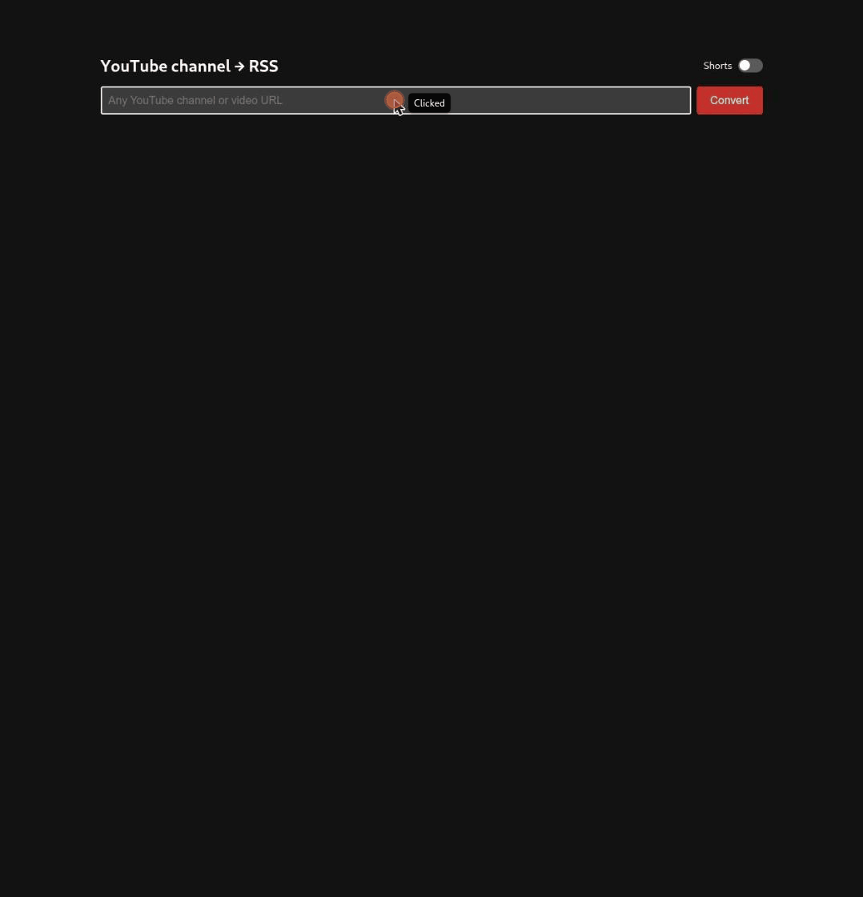

# youtube-rss

A tiny website that turns a YouTube channel URL into its RSS feed URL.

Accepts `https://www.youtube.com/@handle`, `/channel/UC…`, `/c/name`, `/user/name`, a bare `@handle` or a bare channel ID.



## Run

```sh
docker compose up -d --build
```

Open http://localhost:8080.

## Install on a NAS

Every push to `master` builds `ghcr.io/sirbisgaard/youtube-rss:latest` (linux/amd64).

```yaml
services:
  youtube-rss:
    image: ghcr.io/sirbisgaard/youtube-rss:latest
    ports:
      - "8080:8080"
    restart: unless-stopped
```

## API

```
GET /api/feed?url=<channel url>
→ {"channel_id": "UC…", "feed_url": "https://www.youtube.com/feeds/videos.xml?channel_id=UC…"}
```

## Disclaimer

youtube-rss is not associated with YouTube or Google LLC in any way, and is not endorsed or supported by them.
It only builds the public feed URL YouTube already publishes for a channel.

### Use of LLMs (AI)

LLMs were used to write parts of this code. I review it, I test it, I'm responsible for it.
